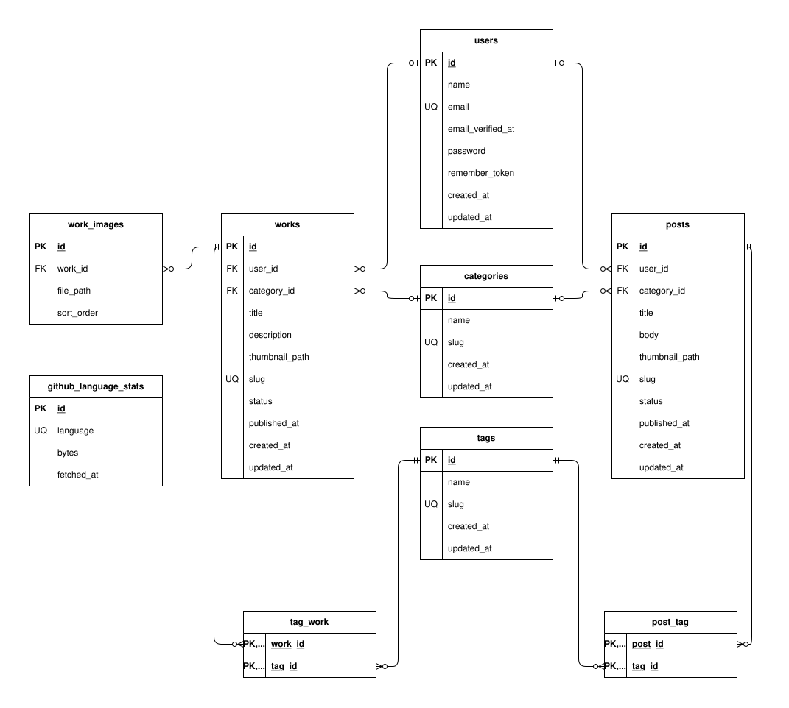

# ポートフォリオ・ブログ管理システム（Laravel 版）

ブログ記事（posts）と制作アプリ（works）を管理画面から投稿・編集し、公開ページに表示するポートフォリオサイトです。

最初はフレームワークを使わず、素の PHP（PDO）と MySQL で作りました（[素の PHP 版のリポジトリ](https://github.com/Wild-River/kadai09_auth)）。このリポジトリは、その機能とデータベース設計を引き継いで、Laravel で作り直したものです。

---

## 主な機能

サイトは、訪問者が見る公開ページと、その内容を更新する管理画面に分かれています。

### 公開ページ

- トップページ：新着記事3件、制作アプリ6件、GitHub の使用言語の比率
- ブログ記事・制作アプリの一覧と詳細（公開済みのものだけ表示）
- 制作アプリのギャラリー画像は、クリックで拡大表示（ライトボックス）

### 管理画面（`/admin`）

- ログイン・ログアウト（管理者は1人だけ。ユーザー登録やパスワードリセットは置いていません）
- ブログ記事・制作アプリの登録・編集・削除と、「下書き」「公開済み」の切り替え
- カテゴリ・タグの登録・編集・削除と、記事・アプリへの付与（タグは複数選べます）
- サムネイル画像のアップロード・差し替え・削除
- 制作アプリへのギャラリー画像の追加（まとめて複数枚）と、選んだ画像の削除

---

## 使用技術

| 分類 | 技術 |
|---|---|
| バックエンド | PHP 8.5 / Laravel 13 |
| 認証 | Laravel Breeze（Blade） |
| フロントエンド | Blade、Tailwind CSS（管理画面）、自作の CSS・JavaScript（公開ページ）、Vite |
| データベース | MySQL 8.4 |
| 外部 API | GitHub REST API |
| 開発環境 | Docker（Laravel Sail） |

---

## 素の PHP 版から変えたところ

機能は素の PHP 版と同じまま、実装を Laravel の仕組みに置き換えました。

| 機能 | 素の PHP 版 | Laravel 版 |
|---|---|---|
| DB 操作 | PDO とプリペアドステートメント | Eloquent（モデルとリレーション） |
| 入力チェック | 各ページに手書き | FormRequest（エラーメッセージは日本語） |
| 認証 | セッションを自前で管理 | Breeze と `auth` ミドルウェア |
| CSRF 対策 | なし | すべてのフォームに `@csrf` |
| URL | `single.php?id=1` | `/posts/{slug}`（slug によるルートモデルバインディング） |
| 公開状態 | `WHERE status = 'published'` | `PublishStatus` Enum と `published()` スコープ |
| 画像の保存 | `move_uploaded_file` | `Storage::disk('public')` |
| 画像のチェック | 拡張子とサイズだけ | `image` / `mimes` / `max` ルール（中身の形式も確認） |
| GitHub 連携 | cURL の関数 | `GitHubLanguageService`（Http クライアント、並列で取得） |

---

## 工夫した点

置き換えにあわせて、次の3点に気を配りました。

### 下書きを見せない

公開ページでは `published()` スコープで、公開済みのものだけを取得します。下書きの記事は、URL を直接入力しても 404 になります。

### 画像ファイルの後始末

サムネイルやギャラリー画像を差し替え・削除したとき、また記事やアプリそのものを削除したときに、ストレージ上の古いファイルも削除します。入力エラーのときは、古い画像はそのまま残ります。

素の PHP 版では、制作アプリを削除してもギャラリー画像のファイルが残っていました。これも今回直しています。

### GitHub API の結果を DB にキャッシュ

- リポジトリ一覧と各リポジトリの使用言語を取得し、言語ごとのコード量を合計して比率を出しています。
- リポジトリの数だけ API を呼ぶため、結果を `github_language_stats` テーブルに保存し、24時間はキャッシュから表示します。
- 取得に失敗したときは、古いキャッシュを表示して画面が壊れないようにしています。一部のリポジトリだけ失敗した場合も、中途半端な合計でキャッシュを上書きしません。

---

## DB 設計

テーブル設計は素の PHP 版から引き継ぎ、管理者のテーブルだけを Laravel 標準の `users` に置き換えました。



| テーブル | 内容 |
|---|---|
| `users` | 管理者（1人） |
| `posts` | ブログ記事（カテゴリ・サムネイル・公開状態・slug） |
| `works` | 制作アプリ（カテゴリ・サムネイル・公開状態・slug） |
| `work_images` | 制作アプリのギャラリー画像（並び順つき） |
| `categories` / `tags` | カテゴリとタグ（posts と works で共通） |
| `post_tag` / `tag_work` | 記事・アプリとタグの中間テーブル |
| `github_language_stats` | GitHub の言語別コード量のキャッシュ |

カテゴリや管理者を削除すると、記事・アプリ側の参照は `NULL` になります。記事・アプリを削除すると、タグとの紐付けとギャラリー画像の行も一緒に消えます。

---

## ディレクトリ構成（主なもの）

```
app/
├── Enums/PublishStatus.php        # 下書き・公開済み
├── Http/
│   ├── Controllers/Site/          # 公開ページ（トップ / posts / works）
│   ├── Controllers/Admin/         # 管理画面（posts / works / categories / tags）
│   └── Requests/Admin/            # 入力チェック（FormRequest）
├── Models/                        # Post, Work, WorkImage, Category, Tag, GitHubLanguageStat
└── Services/GitHubLanguageService.php
config/admin.php                   # 管理者の情報（.env から読む）
database/seeders/AdminUserSeeder.php
lang/ja/                           # 日本語のエラーメッセージ
resources/
├── css/site.css, js/site.js       # 公開ページの CSS・JS（素の PHP 版から移植）
└── views/
    ├── site/                      # 公開ページ
    └── admin/                     # 管理画面
```
